# Hümeyra — ikas Studio theme

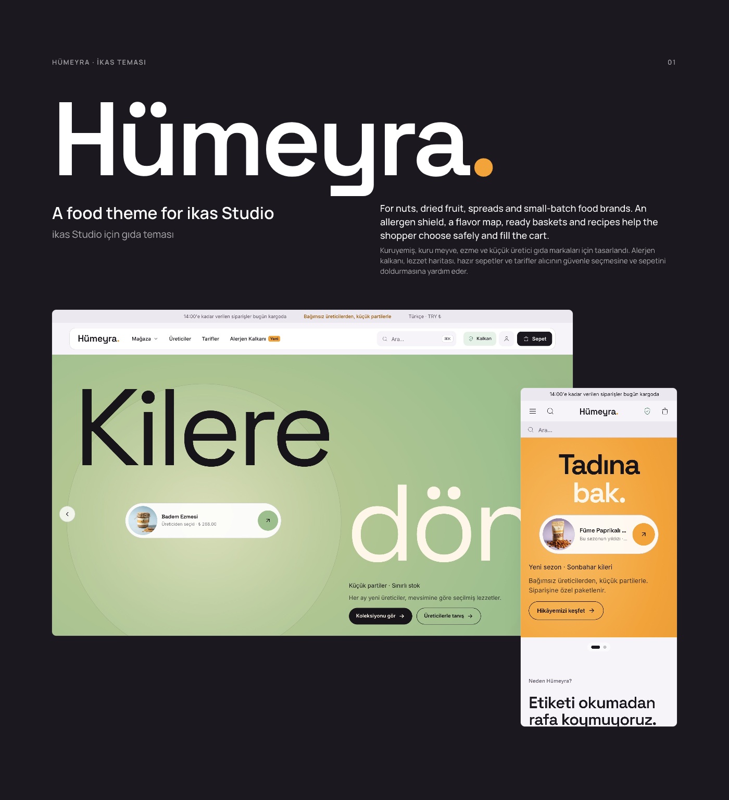

Kuruyemiş, kuru meyve ve küçük üretici gıda markaları için bir ikas teması. Bu sayfada temanın **öne çıkan kurguları** görsellerle anlatılıyor: editörde ya da panelde yaptığın ayarın sitede nasıl göründüğü.
*A food theme for ikas. This page shows the key setups: what you do in the editor or admin panel, and what happens on the site.*

**ikas tema mağazası / ikas Theme Store:** https://themes.ikas.com/tr/temalar/0f34cffe-5ba4-4fef-8c05-2f05668f936e

**Canlı önizleme / Live preview:** https://vuu76-dev-humeyra.myikas.com

---

## 1. Alerjen Kalkanı · Allergen shield

Temanın en önemli özelliği. Alıcı alerjenlerini bir kez seçer; seçim her sayfada hatırlanır.
*The shopper picks their allergens once; the choice is remembered on every page.*

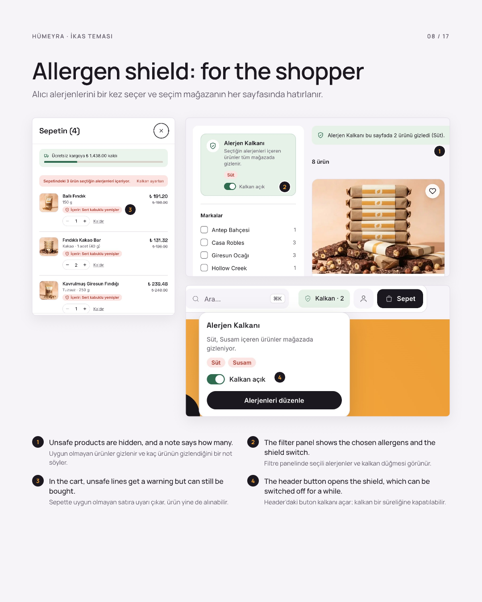

| Nerede | Ne olur |
|---|---|
| Koleksiyon, kategori sayfası, öneriler, lezzet haritası, arama | Uygun olmayan ürün gizlenir ve kaç ürünün gizlendiğini bir not söyler. |
| Ürün sayfası, hazır sepetler, kutu oluşturucu, tarif malzemeleri | Ürün yerinde kalır ve alerjen uyarısı görünür. |
| Yan sepet ve sepet sayfası | Uygun olmayan satırda uyarı çıkar; ürün yine de satın alınabilir. |
| Header | Kalkan butonu seçili alerjen sayısını gösterir; kalkan buradan açılıp kapatılır. |

*Lists and search hide unsafe products with a note; baskets, recipes and the product page warn; the cart warns on each line.*

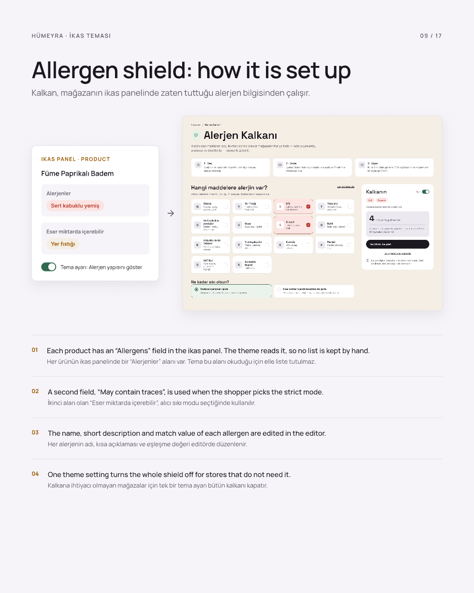

**Kurulum, 4 adım:**

1. **Panel:** Ürünler › Tanımlamalar › Özel Alanlar. `Alerjenler` adında çoklu seçim bir alan aç (ör. Sert kabuklu yemiş, Süt, Gluten).
2. **Panel:** İstersen ikinci bir alan aç: `Eser miktarda içerebilir`. Alıcı "sıkı mod"u seçerse bu alan da hesaba katılır.
3. **Editör:** Alerjen Kalkanı sayfası › Alerjen Kalkanı bölümü › **Alerjen Seçici › Alerjenler**. Her alerjende ad, kısa açıklama ve **eşleşme değeri** var; eşleşme değeri paneldeki değerle harfi harfine aynı olmalı.
4. **Editör:** Tema ayarları › Alerjen kalkanı › **Alerjen yapısını göster (tüm tema)**. Kapatırsan kalkan bütün mağazadan kalkar (header butonu, gizleme, uyarılar).

> Metinler ("{count} ürün gizlendi", "Alerjenin: {allergens}") her bölümün **Metinler** grubundan değişir.
> *All shield texts are editable in each section's Texts group.*

---

## 2. Lezzet haritası · Flavor map

Ürünler bir haritada durur: üstte tatlı, altta tuzlu, solda yumuşak, sağda çıtır. Konumu paneldeki puanlar belirler.
*Products sit on a map by their taste scores; no pins are placed by hand.*

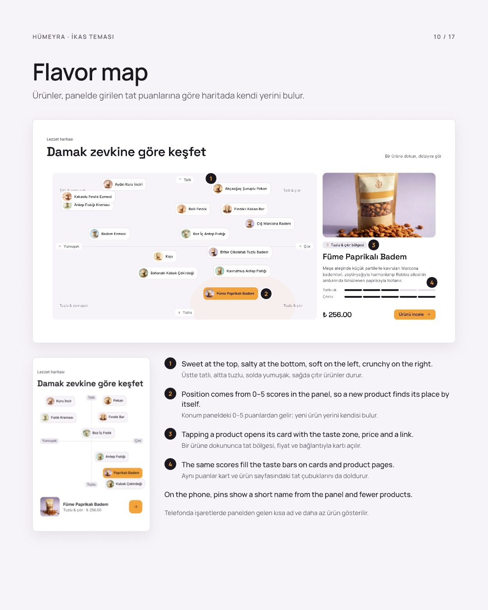

1. **Panel:** Özel Alanlar'da 0–5 arası sayı alanları aç: `Tatlılık`, `Tuzluluk`, `Çıtırlık` (istersen `Acılık`). Ürünlere puan gir.
2. **Editör:** Lezzet haritası bölümü › **Veri** › Yatay eksen alanı, Dikey eksen üst yön alanı, Dikey eksen alt yön alanı. Her birine ilgili özel alanı seç.
3. **Editör:** Veri › **Mobil kısa ad alanı** (telefonda işaretlerde ad yerine görünür) ve Harita ve Eksenler › **Mobilde en fazla pin**.

> Aynı puanlar ürün kartındaki ve ürün sayfasındaki tat çubuklarını da doldurur (Ürün detayı › Tat Profili).
> *The same scores fill the taste bars on cards and product pages.*

---

## 3. Hazır sepetler ve kutu oluşturucu · Ready baskets and box builder

Hazır sepet tek dokunuşla sepete eklenir; "Düzenle" ile adet değiştirilir, ürün çıkarılır ya da eklenir. Kutu oluşturucuda alıcı 3'lü, 6'lı ya da 12'li kutuyu kendisi doldurur.
*One tap adds a ready basket; the shopper fills the box builder themselves.*

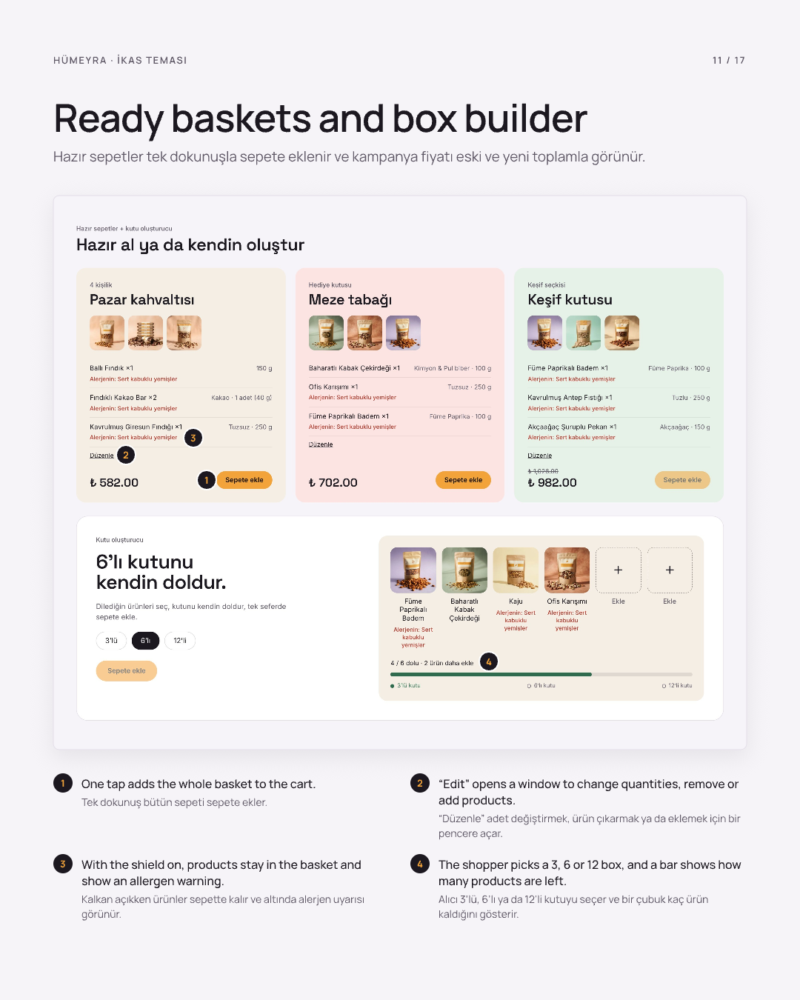

- **Editör:** Hazır sepetler bölümü › **Hazır sepetler** listesi. Her sepette **Veri › Kutu içeriği** (herhangi bir ürün listesi) ve adetler (`1,2,1` gibi).
- **Editör:** Kutu oluşturucu › **Başlangıç ürünleri**, **Eklenebilir ürünler (+)**, Kutu boyutları › **Varsayılan boyut** ve **Kutu dolmadan sepete eklenebilsin**.
- Kampanya fiyatı varsa kart eski ve yeni toplamı birlikte gösterir.

*Basket contents, box sizes and the pickable products all come from the editor.*

---

## 4. Tariften sepete · From recipe to cart

Tarifteki her malzeme gerçek bir ürün. Alıcı evde olanların işaretini kaldırır, **Eksikleri sepete ekle** kalanları ekler; sepette olanı tekrar eklemez.
*Every ingredient is a real product; "Add missing to cart" fills the gaps.*

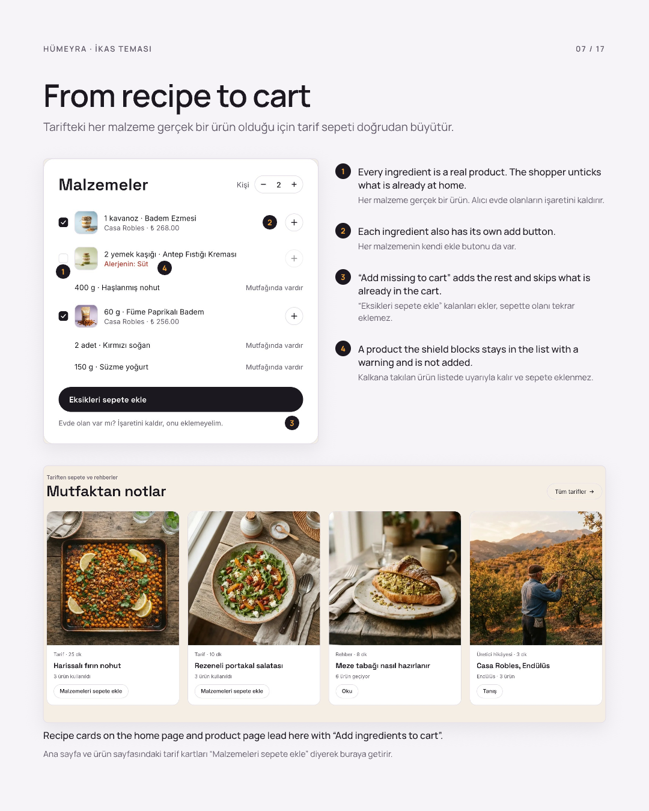

1. **Editör:** Tarif sayfası › Tarif bölümü › **Malzemeler › Malzeme Listesi**. Her malzemede miktar yazısı ve **Veri › Ürün**.
2. Ürün seçmezsen satır "Mutfağında vardır" olarak görünür ve sepete eklenmez.
3. Ana sayfadaki Tarifler bölümünde her kartın butonu ("Malzemeleri sepete ekle") alıcıyı tarif sayfasına götürür; buton yazısı ve linki kart ayarlarından değişir.

> Kalkana takılan malzeme listede uyarıyla kalır ve "Eksikleri sepete ekle" onu atlar.
> *A blocked ingredient stays with a warning and is skipped.*

---

## 5. Ürün sayfası · Product page

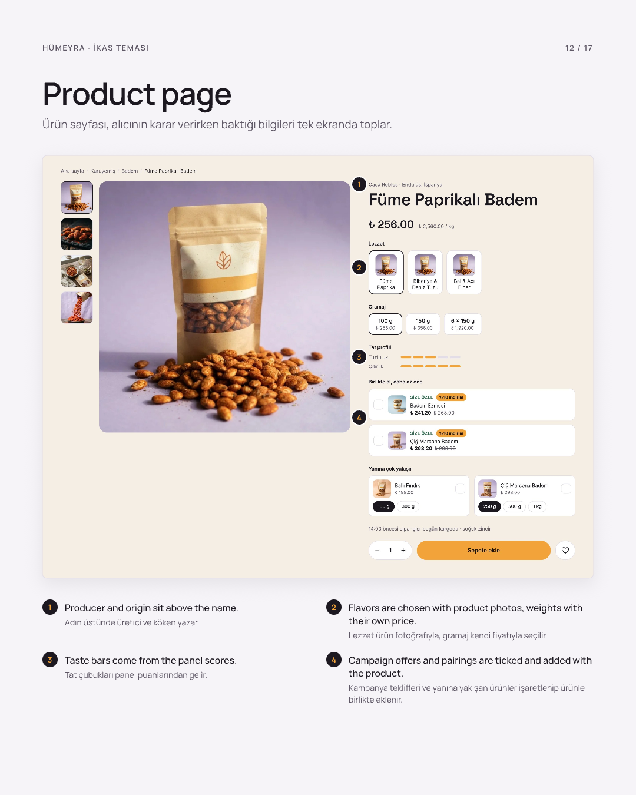

| İşaret | Ne | Nereden |
|---|---|---|
| 1 | Üretici ve köken satırı | Panel: Marka · Editör: Ürün detayı › Veri › Menşe alanı |
| 2 | Fotoğraflı lezzet ve fiyatlı gramaj | Panel: Ürün grubu ve varyantlar |
| 3 | Tat çubukları | Editör: Ürün detayı › Tat Profili (1.–3. çubuk alanı) |
| 4 | Kampanya teklifleri ve "Yanına çok yakışır" | Panel: Kampanyalar · Editör: Ürün detayı › Yanına yakışır › Ürünler |

*Producer line, flavor and weight choice, taste bars, offers and pairings.*

---

## 6. Sepeti büyüten kurgular · Cart-building flows

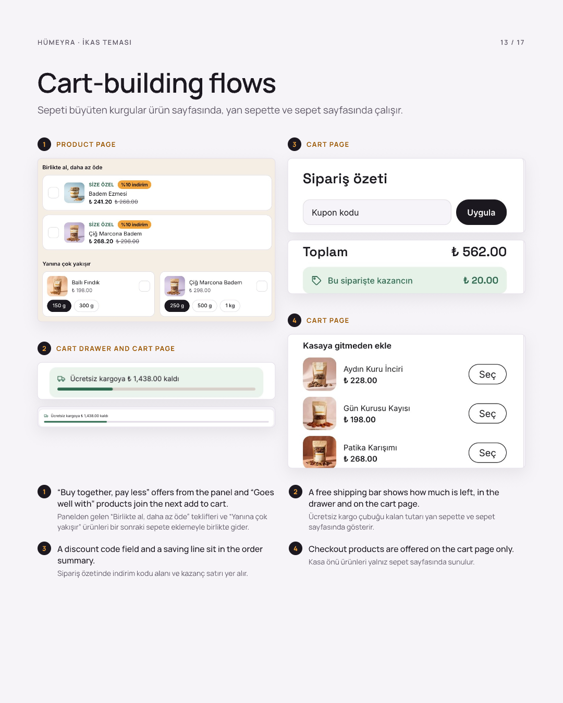

| İşaret | Kurgu | Nereden |
|---|---|---|
| 1 | "Birlikte al, daha az öde" ve "Yanına çok yakışır" | Panel: Kampanyalar · Editör: Ürün detayı › Yanına yakışır |
| 2 | Ücretsiz kargo çubuğu (yan sepet ve sepet sayfası) | Editör: Header › Sepet Çekmecesi › Ücretsiz kargo barı · Sepet › Ücretsiz Kargo |
| 3 | İndirim kodu ve "Bu siparişte kazancın" | Panel: Kampanyalar ve indirim kodları |
| 4 | Kasa önü ürünleri (yalnız sepet sayfası) | Editör: Sepet › Kasa önü ürünleri › Kasa önü alanını göster, Ürünler |

*Hazır sepetler (bölüm 3) ve tarifler (bölüm 4) de sepete aynı anda birden fazla ürün ekler.*
*Ready baskets and recipes also add several products at once.*

---

## 7. Panel → site · Admin panel → Storefront

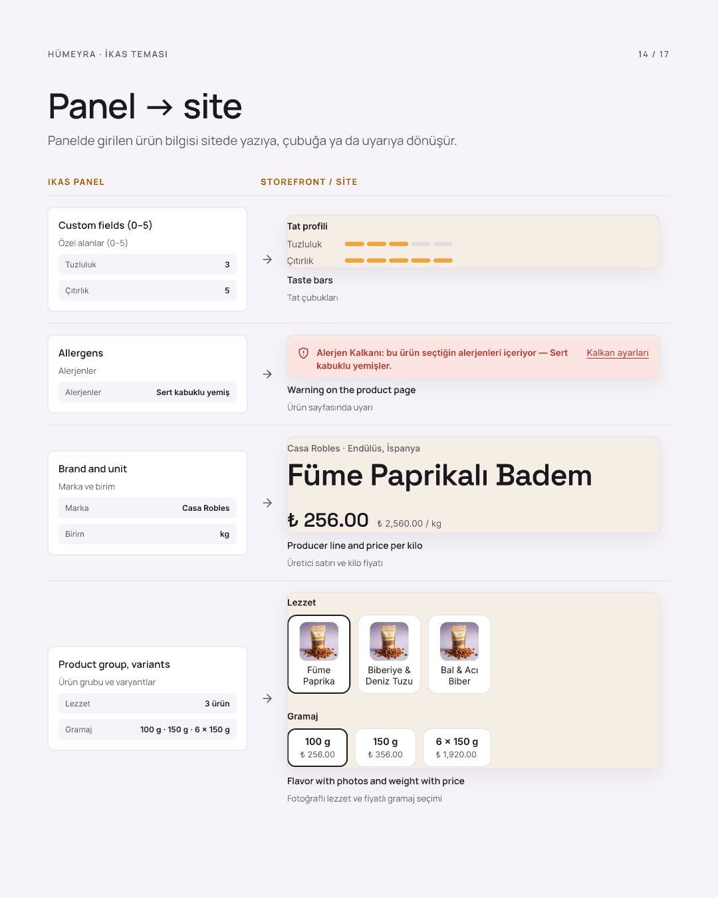

| Panelde | Sitede |
|---|---|
| Özel alanlar (0–5) | Tat çubukları ve lezzet haritası |
| Alerjenler | Ürün sayfasında uyarı, kalkan |
| Marka ve birim | Üretici satırı ve kilo fiyatı |
| Ürün grubu ve varyantlar | Fotoğraflı lezzet ve fiyatlı gramaj seçimi |

*What you enter in the panel shows up on the site without extra setup.*

---

## 8. Renkler ve yazı · Colors and type

Temada 16 renkten oluşan tek bir renk şeması var: **Hümeyra · Açık**. Her renk tema ayarlarındaki renk şemasından değişir ve bütün site bu değişikliği izler. Yazı için 6 metin stili tanımlı (Display, Başlık, Gövde, Gövde Vurgulu, Etiket UI, Caption); font ve boyutlar bu stillerden değişir. Varsayılan fontlar başlıkta Space Grotesk, metinde Inter.
*One color scheme of 16 colors and six text styles, all editable in theme settings.*

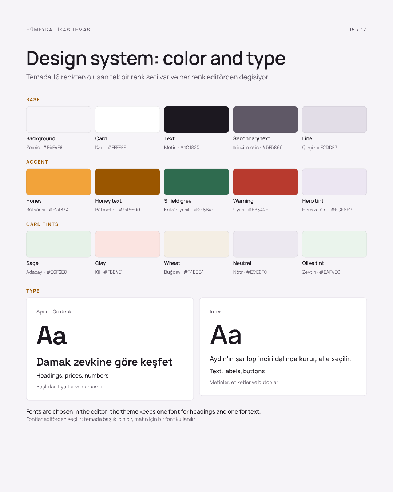

---

## 9. Mobil · Mobile

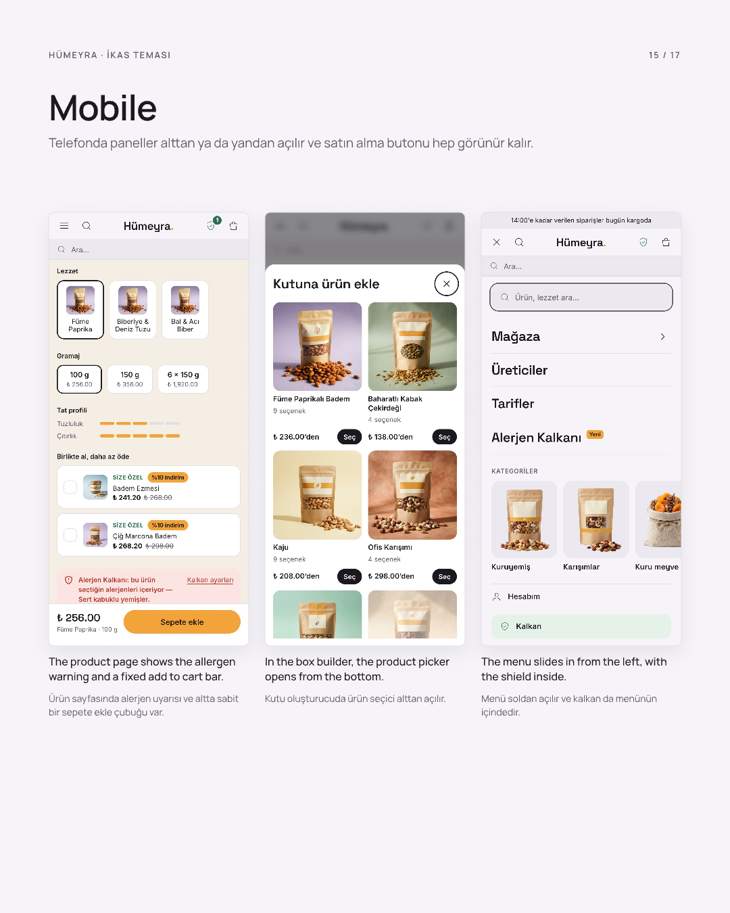

- Ürün sayfasında altta sabit "Sepete ekle" çubuğu var.
- Ürün seçici, filtreler ve hızlı bakış alttan açılan panellerde gösterilir.
- Menü soldan açılır; alt menüler kendi panellerinde açılır ve Kalkan menünün içindedir.

*Bottom panels, a fixed add to cart bar and a left menu.*

---

## 10. Editörde nerede? · Where in the editor

Her görselde solda editör paneli, sağda sitedeki karşılığı var. Aynı numara aynı ayarı gösterir. Paneldeki değerler önizleme mağazasındaki gerçek değerlerdir.
*Left: the editor panel. Right: the storefront. Matching numbers show which setting changes what.*

### 10.1 Header

Header her sayfada aynıdır. Duyuru şeridi, menü ve Alerjen Kalkanı butonu buradan yönetilir.
*The header is the same on every page.*

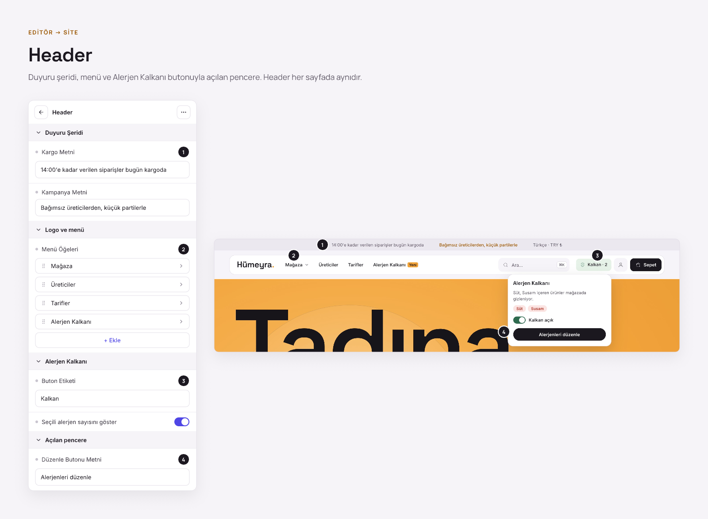

| # | Editörde | Sitede |
|---|---|---|
| 1 | `Duyuru Şeridi › Kargo Metni` | Üstteki duyuru |
| 2 | `Logo ve menü › Menü Öğeleri` | Ana menü |
| 3 | `Alerjen Kalkanı › Buton Etiketi` | Kalkan butonu (seçili alerjen sayısıyla) |
| 4 | `Alerjen Kalkanı › Açılan pencere › Düzenle Butonu Metni` | Açılan penceredeki buton |

### 10.2 Hero

Ana sayfanın ilk ekranı. Her slayt ayrı ayarlanır; listeden bir slayta tıklayınca alanları açılır.
*Each slide of the first screen has its own settings.*

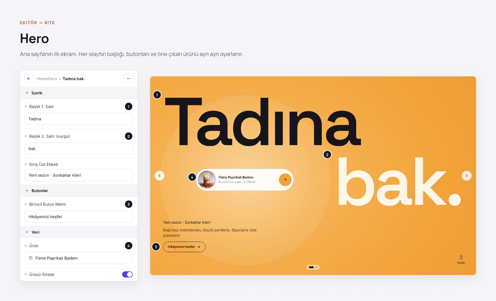

| # | Editörde | Sitede |
|---|---|---|
| 1 | `İçerik › Başlık 1. Satır` | Büyük başlığın ilk satırı |
| 2 | `İçerik › Başlık 2. Satır (vurgu)` | Açık renkli ikinci satır |
| 3 | `Butonlar › Birincil Buton Metni` | Butondaki yazı |
| 4 | `Veri › Ürün` | Öne çıkan ürün kartı |

### 10.3 Alerjen Kalkanı sayfası

Alıcının alerjenlerini seçtiği sayfa.
*The page where the shopper picks their allergens.*

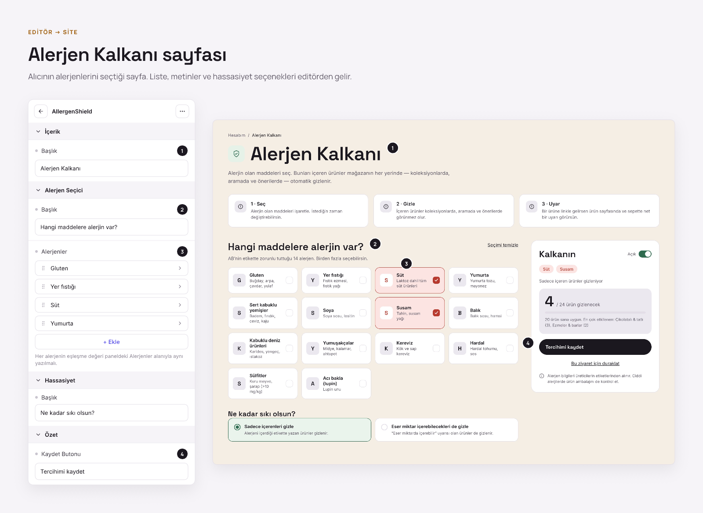

| # | Editörde | Sitede |
|---|---|---|
| 1 | `İçerik › Başlık` | Sayfa başlığı |
| 2 | `Alerjen Seçici › Başlık` | Seçicinin başlığı |
| 3 | `Alerjen Seçici › Alerjenler` | Alerjen kartları (her birinde ad, açıklama, eşleşme değeri) |
| 4 | `Özet › Kaydet Butonu` | Kaydet butonu |

### 10.4 Lezzet haritası

Ürünler paneldeki 0–5 puanlarına göre yerleşir; Veri grubunda hangi özel alanın hangi eksene gittiği seçilir.
*Axis names and data fields are set here.*

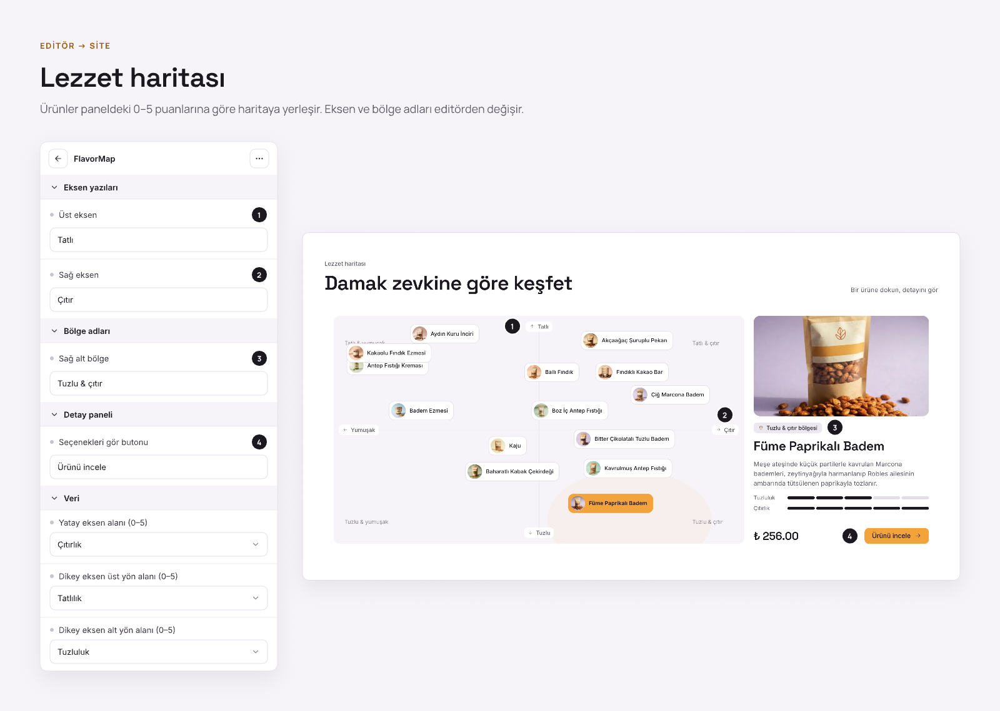

| # | Editörde | Sitede |
|---|---|---|
| 1 | `Eksen yazıları › Üst eksen` | Üstteki eksen adı |
| 2 | `Eksen yazıları › Sağ eksen` | Sağdaki eksen adı |
| 3 | `Bölge adları › Sağ alt bölge` | Seçili ürünün bölge etiketi |
| 4 | `Detay paneli › Seçenekleri gör butonu` | Detay kartındaki buton |

### 10.5 Hazır sepetler

Her sepet listeden açılır; adı, ürünleri ve adetleri ayrı ayarlanır.
*Each ready basket has its own name, products and quantities.*

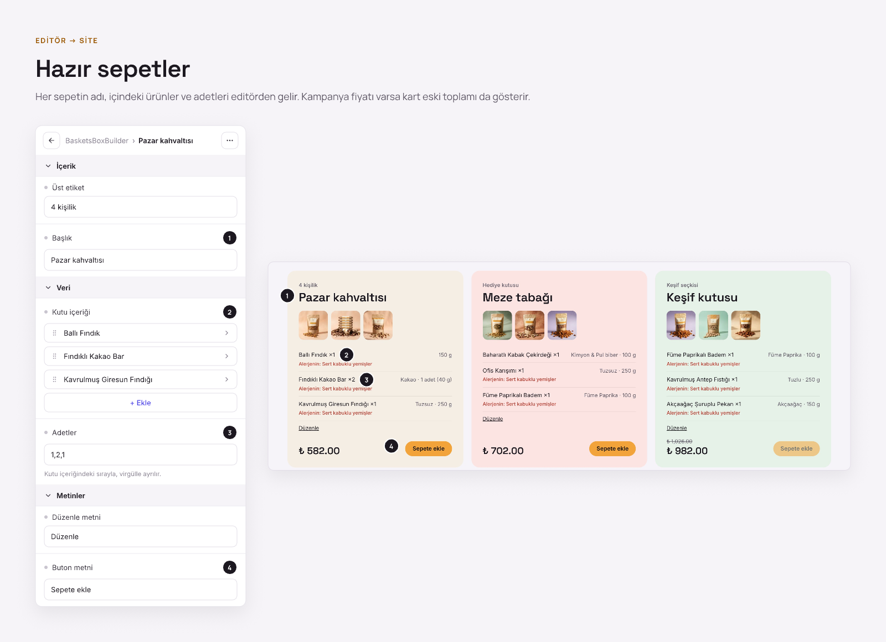

| # | Editörde | Sitede |
|---|---|---|
| 1 | `İçerik › Başlık` | Sepetin adı |
| 2 | `Veri › Kutu içeriği` | Sepetteki ürünler |
| 3 | `Veri › Adetler` | Ürün adetleri (×2 gibi) |
| 4 | `Metinler › Buton metni` | Sepete ekle butonu |

### 10.6 Kutu oluşturucu

Alıcı kutu boyutunu seçip doldurur.
*The shopper picks a box size and fills it.*

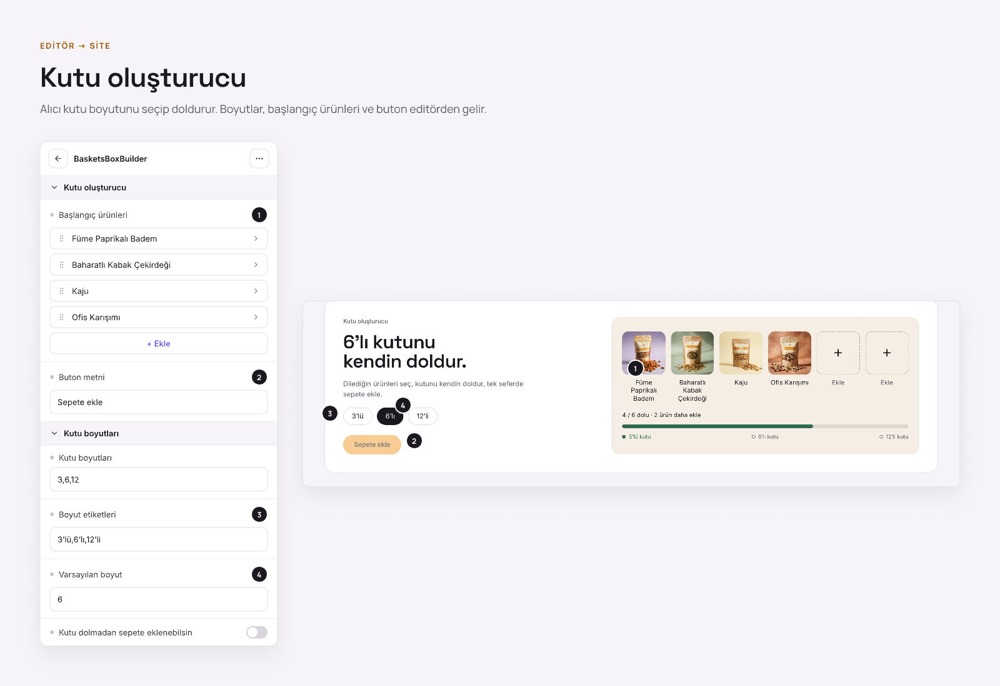

| # | Editörde | Sitede |
|---|---|---|
| 1 | `Kutu oluşturucu › Başlangıç ürünleri` | Kutuda hazır gelen ürünler |
| 2 | `Kutu oluşturucu › Buton metni` | Sepete ekle butonu |
| 3 | `Kutu boyutları › Boyut etiketleri` | Boyut seçenekleri |
| 4 | `Kutu boyutları › Varsayılan boyut` | İlk açılışta seçili boyut |

### 10.7 Tarif

Tarifteki her malzeme bir ürüne bağlanır; ürün seçilmezse satır “Mutfağında vardır” olarak görünür.
*Each ingredient links to a product.*

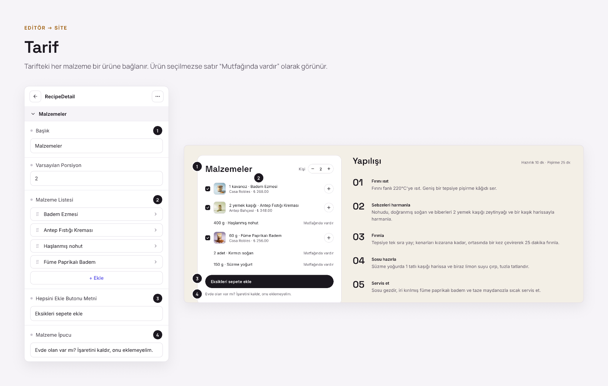

| # | Editörde | Sitede |
|---|---|---|
| 1 | `Malzemeler › Başlık` | Malzemeler başlığı |
| 2 | `Malzemeler › Malzeme Listesi` | Malzeme satırları (miktar ve ürün) |
| 3 | `Malzemeler › Hepsini Ekle Butonu Metni` | Eksikleri sepete ekle butonu |
| 4 | `Malzemeler › Malzeme İpucu` | Butonun altındaki not |

### 10.8 Ürün sayfası

Köken satırı ve tat çubukları paneldeki özel alanlardan gelir.
*Origin line and taste bars come from custom fields.*

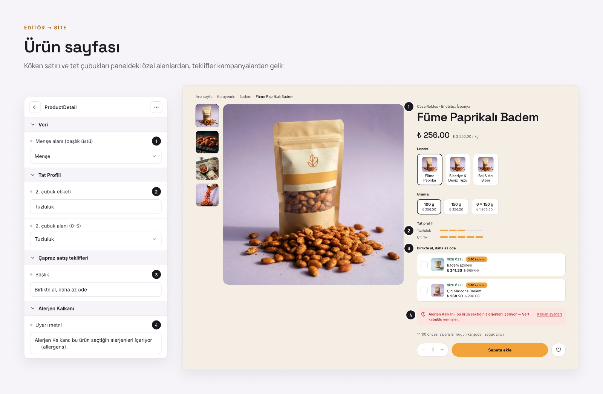

| # | Editörde | Sitede |
|---|---|---|
| 1 | `Veri › Menşe alanı (başlık üstü)` | Başlığın üstündeki köken satırı |
| 2 | `Tat Profili › 2. çubuk etiketi / alanı` | Tat çubuğu |
| 3 | `Çapraz satış teklifleri › Başlık` | Teklifler başlığı |
| 4 | `Alerjen Kalkanı › Uyarı metni` | Kalkan uyarısı |

### 10.9 Sepet

Sepet sayfasının ücretsiz kargo, soğuk zincir ve kalkan metinleri.
*Free shipping, cold chain and shield texts on the cart page.*

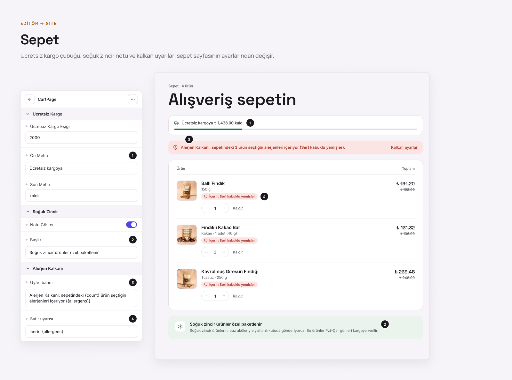

| # | Editörde | Sitede |
|---|---|---|
| 1 | `Ücretsiz Kargo › Ön Metin` | Kargo çubuğundaki yazı |
| 2 | `Soğuk Zincir › Başlık` | Soğuk zincir notu |
| 3 | `Alerjen Kalkanı › Uyarı bandı` | Sepetin üstündeki uyarı |
| 4 | `Alerjen Kalkanı › Satır uyarısı` | Ürün satırındaki uyarı |

### 10.10 Footer

Footer her sayfada aynıdır.
*The footer is the same on every page.*

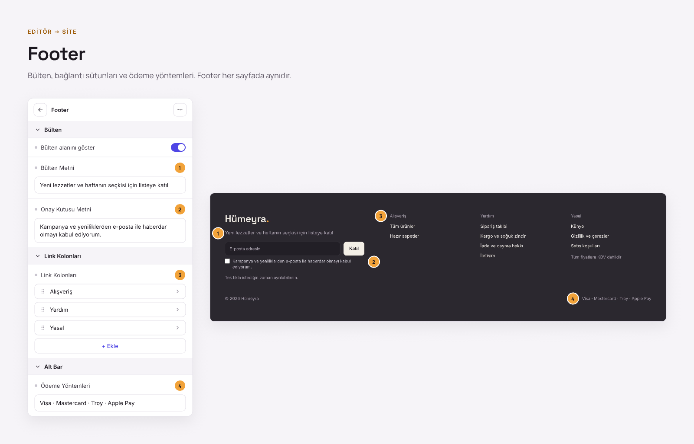

| # | Editörde | Sitede |
|---|---|---|
| 1 | `Bülten › Bülten Metni` | Bülten yazısı |
| 2 | `Bülten › Onay Kutusu Metni` | E-posta izin kutusu |
| 3 | `Link Kolonları › Link Kolonları` | Bağlantı sütunları |
| 4 | `Alt Bar › Ödeme Yöntemleri` | Ödeme yöntemleri satırı |

---

Lisans: dokümantasyon ve görseller [CC BY 4.0](LICENSE).
*License: documentation and images under CC BY 4.0.*
